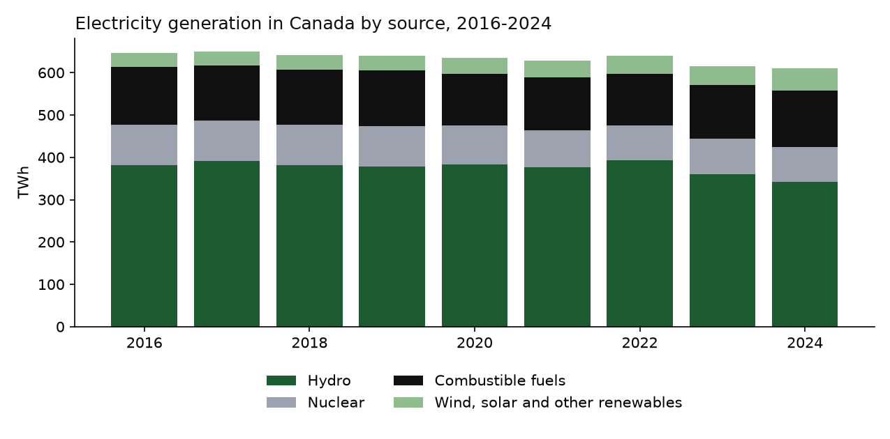
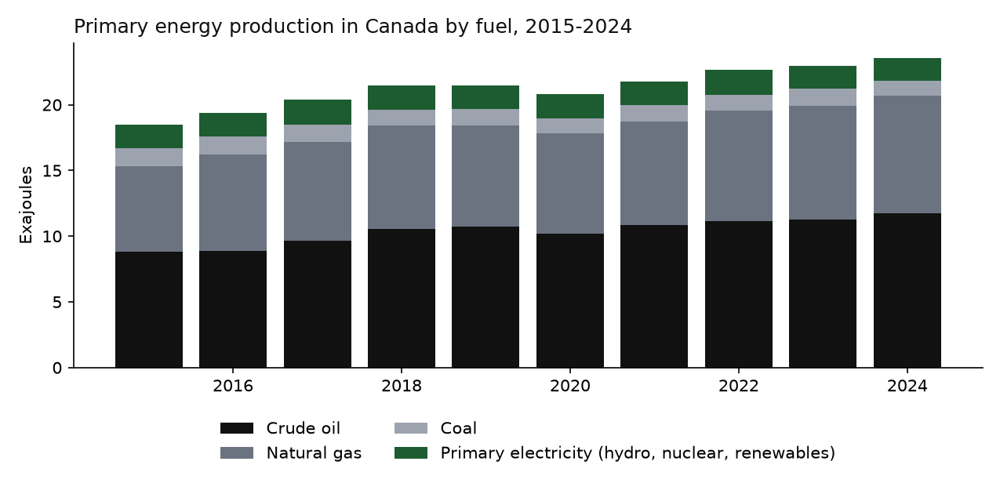
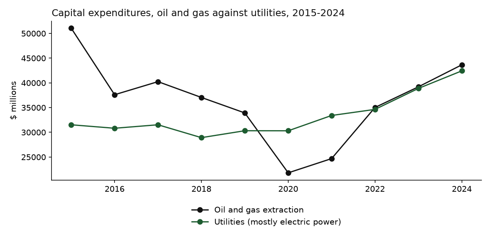

# Canada's Energy Transition: Renewables Are Growing, Oil and Gas Are Still Growing Faster

Munzeleen Sarwar

November 2026

## Bottom line

Canada's energy transition is real in electricity and absent in production. Wind generation rose five times and solar twenty times between 2015 and 2024, but both started from almost nothing, and hydro, the backbone of Canadian power, fell 9% over the same period on drought. Total electricity generation barely moved, up 3%, and the fossil share of power was flat at about one fifth. What Canada produces tells the opposite story: crude oil output rose 33% and natural gas 38%, so the fossil share of primary energy production rose from 87.0% to 88.5%. The money is moving slowly in the other direction: capital spending by oil and gas extraction is still below its 2014 peak, while utilities spending rose 35% and is set to pass oil and gas in 2025. The transition is happening in power and in capital spending, not in what Canada produces.

## 1. Power: renewables grow, hydro falls, fossil holds its share

Wind and solar are the fastest growing sources in Canadian electricity, but they remain small. Wind rose from 8.85 terawatt hours in 2015 to 45.84 in 2024, and solar from 0.26 to 5.23. Together they were 8.4% of generation in 2024, up from 1.5% in 2015. Hydro still dominates at 56.1%, but it fell from 375.62 terawatt hours in 2015 to 341.82 in 2024, with the sharpest drops in 2023 and 2024, when dry conditions cut river flows. Nuclear fell 17% over the same period as reactors went down for refurbishment. Total generation was nearly flat, 592.76 terawatt hours in 2015 against 609.49 in 2024, so the growth in wind and solar mostly filled the gap left by hydro and nuclear rather than replacing fossil fuels. Combustible fuels supplied 22.1% of power in 2024, against 21.2% in 2016, and non-renewable combustible fuels alone were 20.5%. Renewables were 66.0% of generation in 2024, but that figure is mostly hydro built decades ago, not new capacity.

| Terawatt hours | 2015 | 2020 | 2024 | Change 2015-2024 |
|---|---:|---:|---:|---:|
| Total generation | 592.76 | 635.57 | 609.49 | +2.8% |
| Hydro | 375.62 | 382.62 | 341.82 | -9.0% |
| Nuclear | 98.37 | 92.65 | 81.74 | -16.9% |
| Wind | 8.85 | 36.26 | 45.84 | +417.8% |
| Solar | 0.26 | 2.57 | 5.23 | +1,922.3% |
| Combustible fuels | n/a | 121.35 | 134.57 | n/a |
| Renewables (hydro, wind, solar, tidal, biomass) | n/a | 430.61 | 402.25 | n/a |

Source: Statistics Canada table 25-10-0015-01. The combustible fuels split is published from 2016, so no 2015 figure is shown. Renewables in 2020 were 67.8% of generation and 66.0% in 2024.

## 2. Production: oil and gas grew by a third

What Canada produces moved the other way. Crude oil production rose from 8.84 exajoules in 2015 to 11.76 in 2024, up 33.0%, and natural gas from 6.47 to 8.91, up 37.7%. Coal fell 15.2% and primary electricity, hydro, nuclear and other renewables combined, fell 4.8% on the same hydro drought. Total primary energy production rose 28.8% to 24.66 exajoules, and oil and gas supplied 20.67 of it. The fossil share of production rose from 87.0% to 88.5%, while primary electricity fell from 9.5% to 7.0% of production. In other words, Canada produced more energy in 2024 than in 2015, and a larger share of it came from oil and gas.

| Exajoules | 2015 | 2020 | 2024 | Change 2015-2024 |
|---|---:|---:|---:|---:|
| Crude oil | 8.84 | 10.22 | 11.76 | +33.0% |
| Natural gas | 6.47 | 7.60 | 8.91 | +37.7% |
| Coal | 1.35 | 1.15 | 1.15 | -15.2% |
| Primary electricity (hydro, nuclear, renewables) | 1.81 | 1.85 | 1.72 | -4.8% |
| Total primary energy | 19.15 | 21.75 | 24.66 | +28.8% |
| Fossil share of primary energy | 87.0% | 87.2% | 88.5% | +1.5 points |

Source: Statistics Canada table 25-10-0029-01. The four fuels shown sum to 23.54 exajoules in 2024; the rest is natural gas liquids, steam and other fuels.

## 3. Money: the capital is moving, slowly

Capital spending shows the turn more clearly than production does. Oil and gas extraction spent $51.1 billion in 2015, crashed to $21.8 billion in 2020, and recovered to $43.7 billion in 2024, still 43% below its 2014 peak of $76.1 billion. Utilities, mostly electric power, spent $31.5 billion in 2015 and $42.4 billion in 2024, up 35%, rising almost every year. The two lines met in 2024 and, on intentions, utilities pass oil and gas in 2025, $47.0 billion against $42.0 billion. The power-specific split, from Natural Resources Canada's Energy Fact Book, puts electric power generation and distribution at $32 billion in 2024 against $43 billion for oil and gas extraction, out of $89 billion of energy capital spending in total. Money is moving toward power. Production has not followed yet.

| $ millions | 2015 | 2020 | 2024 | Change 2015-2024 |
|---|---:|---:|---:|---:|
| Oil and gas extraction | 51,065 | 21,805 | 43,652 | -14.5% |
| Utilities | 31,524 | 30,309 | 42,429 | +34.6% |

Source: Statistics Canada table 34-10-0035-01. 2025 figures are intentions: oil and gas $42,038 million, utilities $47,026 million.

## 4. What it means for resource investors

The transition in Canada is uneven, and that unevenness is the investment question. Power is changing: wind and solar are growing fast, utilities are spending more than ever, and fossil fuels still supply a fifth of electricity. Production is not changing: oil and gas output is a third higher than a decade ago, and the fossil share of what Canada produces has risen. The companies that must fund the transition earn their cash from the fuels the transition is meant to replace. Whether they can pay for it depends on their balance sheets, not on the direction of the sector. The next part of this project tests exactly that, running credit risk models on the 12 TSX resource companies in the sustainability scorecard.

## Method and sources

- All data are from Statistics Canada, downloaded as full tables on 16 November 2026: table 25-10-0015-01 (electricity supply and disposition), table 25-10-0029-01 (supply and demand of primary and secondary energy, annual), table 34-10-0035-01 (capital and repair expenditures by industry). The power-specific $32 billion figure is from Natural Resources Canada, Energy Fact Book 2025-2026, Section 2.
- Window is 2015 to 2024, the latest complete year in all three tables. Electricity is monthly data summed to annual totals. Energy is annual data in terajoules, shown here in exajoules. Capital spending is in current dollars.
- The electricity fuel split is charted from 2016 because the published combustible fuels aggregate starts that year, and the non-renewable split and biomass start in 2020. For 2015, only the turbine-type breakdown is published, which is why 2015 appears in the growth rates for hydro, nuclear, wind and solar but not in the fuel split table. Biomass is about 9 terawatt hours a year and sits inside combustible fuels before 2020.
- Utilities in table 34-10-0035-01 covers electric power, natural gas distribution and water, so it is broader than power alone. The chart labels it as mostly electric power and the text gives the power-specific figure separately.
- 2025 and 2026 capital spending figures are intentions from the survey, not actuals, and are quoted only as a forward look.
- Nothing was estimated. Where a series is not published for a year, the cell is left blank and the gap is stated.
- Files: pull_statcan.py (download), analyse.py (analysis and charts), analysis_electricity.csv, analysis_energy_production.csv, analysis_capex.csv, data/ (the three full tables).
